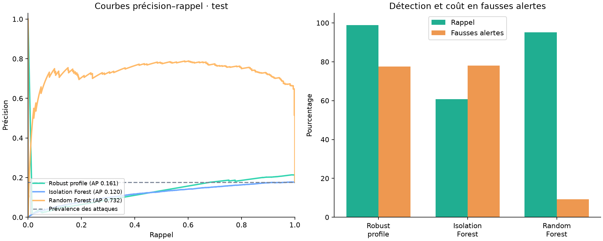
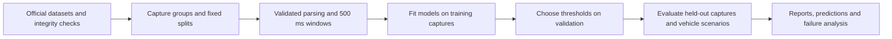

# CAN Sentinel

[](https://github.com/thezanis11/can-sentinel/actions/workflows/checks.yml)

Public repository: [thezanis11/can-sentinel](https://github.com/thezanis11/can-sentinel).

**Automotive cybersecurity: train, compare and inspect intrusion detectors on real CAN traffic.**

Python · CAN bus · anomaly detection · supervised learning · reproducible experiments

CAN Sentinel is an offline research project for detecting suspicious vehicle-network traffic. It includes data acquisition, integrity checks, streaming preprocessing, three trained detectors, capture-separated evaluation, standalone reports and tests. It does not control a vehicle or implement autonomous driving.



## What is included

- **ROAD / ORNL**: all 45 raw capture files, including normal driving, real injection attacks and postprocessed masquerade variants. Four accelerator captures are analyzed separately because injected-frame labels are unavailable.
- **can-train-and-test**: a documented subset of `set_01`, covering known/unknown vehicles and known/unknown attacks. All training files, one test repetition per attack family and official scenario. This is not the full published benchmark.
- **Robust profile**, **Isolation Forest** and **Random Forest**, fitted and evaluated using the same window features.
- Balanced and low-false-positive operating points calibrated on validation data.
- A direct, unadapted ROAD-to-CTT transfer experiment, kept separate from locally retrained CTT models.
- Standalone HTML reports, precision–recall curves, attack-family analysis, per-capture errors, model artifacts, CSV predictions and experiment manifests.

## Read the measured results first

- [ROAD report](reports/index.html) — download/open locally in a browser.
- [ROAD results summary](reports/RESULTS_FR.md).
- [Second-dataset report](reports/ctt/index.html).
- [Second-dataset results](reports/ctt/RESULTS_FR.md).
- [Experimental decisions and limitations](docs/EXPERIMENT_LOG.md).

Measured Random Forest results (validation-selected thresholds):

| Evaluation | F1 | False-positive window rate |
|---|---:|---:|
| ROAD held-out captures | 0.799 | 9.18% |
| CTT known vehicle / known attack | 1.000 | 0.00% |
| CTT unknown vehicle / known attack | 0.511 | 35.32% |
| CTT known vehicle / unknown attack | 0.067 | 0.00% |
| CTT unknown vehicle / unknown attack | 0.066 | 32.47% |

The known/known CTT result covers only four selected captures (107 positive windows). Direct transfer of the frozen ROAD model detects none of the selected CTT attack windows. These failures are part of the result: good recognition of familiar conditions does not establish generalization to unseen attacks or vehicle-specific CAN semantics.

**Research status:** exploratory, not an independently audited or production-ready detector. ROAD test results were inspected during development; the initial strict-threshold experiment is retained. CTT subset selection and the recipe were fixed before its initial test evaluation. Scores apply to 500 ms windows, not individual attacks or real-world safety guarantees. Normal-only models can perform poorly under changed driving conditions; those results are included.

## Quick start — Windows PowerShell

Python 3.14 was used for the measured run. Python 3.11+ is supported by the source, subject to library compatibility. No GPU, CAN hardware, Docker or Linux is required for the offline benchmark.

```powershell
python -m venv .venv
.\.venv\Scripts\python.exe -m pip install -r requirements-lock.txt
.\.venv\Scripts\python.exe -m unittest discover -s tests -v
```

Reproduce ROAD:

```powershell
.\.venv\Scripts\python.exe scripts/download_road.py
.\.venv\Scripts\python.exe -m can_sentinel.cli prepare
.\.venv\Scripts\python.exe -m can_sentinel.cli benchmark
```

After training, `.\.venv\Scripts\python.exe scripts/replay_demo.py` analyzes a real held-out ROAD capture with the saved model and writes `reports/demo_detection.csv`.

Reproduce the documented CTT subset and cross-dataset experiment:

```powershell
.\.venv\Scripts\python.exe scripts/fetch_ctt_subset.py
.\.venv\Scripts\python.exe -m can_sentinel.cli prepare-ctt
.\.venv\Scripts\python.exe -m can_sentinel.cli transfer
.\.venv\Scripts\python.exe -m can_sentinel.cli benchmark --data data/processed/ctt --out reports/ctt --models models/ctt
```

On Linux/macOS, replace `.\.venv\Scripts\python.exe` with `.venv/bin/python`. Downloads are public and require internet access. Preparation reads every selected frame; it does not randomly downsample messages. Several GB of free disk space and a few GB of RAM are recommended. Duration depends on the machine and connection; no fixed runtime is promised.

## Analyze a compatible capture

```powershell
.\.venv\Scripts\python.exe -m can_sentinel.cli detect path/to/capture.log --out reports/my-capture.csv
```

Supported format: classic CAN candump, monotonically increasing timestamps and exactly eight payload bytes, e.g. `(1000.000000) can0 123#0102030405060708`. The ROAD-trained model uses ROAD's anonymized vehicle-specific IDs: a syntactically compatible capture from a different vehicle is not necessarily semantically compatible. For CTT use its adapter and locally trained models. Only load trusted, locally produced `.joblib` artifacts.

## Evaluation design



Features aggregate message counts, interarrival statistics, identifier entropy and per-ID byte statistics over disjoint 500 ms windows. Absolute timestamps, capture names, labels and injection metadata never enter the model matrix. The ID vocabulary comes exclusively from genuine normal training captures; new IDs contribute an unknown-ID fraction.

ROAD is parsed in streaming chunks. CTT files can contain small timestamp reversals; each capture is stably sorted by timestamp in memory before chunked feature extraction. The number of backward steps is recorded per capture. The original files and labels remain intact.

Test-only ID statistics are reduced to the frozen training schema before combining captures, so fuzzing does not create a large dense feature union. Their total message fraction is preserved as an explicit feature.

ROAD original and masquerade variants remain together. Attack repetitions 1/2/3 are assigned to training/validation/test; the singleton coolant attack is test-only. Normal driving captures are split by recording, including unusual benign driving in the test set. See `data.py` and the exported manifest for exact membership. Models fitted only to normal traffic still use attack labels to calibrate their **balanced** operating point; a separate normal-only protocol avoids attack labels entirely for fitting and calibration.

ROAD frame labels are reconstructed from injection interval, ID and wildcard payload, following the published metadata. A window is positive if at least one message matches. These are weak labels and can match legitimate messages. CTT uses the authors' supplied binary labels. Missing-message windows are not synthesized, so total communication loss is outside scope.

We publish precision, recall, F1, average precision (PR-AUC/AP), ROC-AUC, false-positive window rates, source-capture bootstrap intervals and per-family/per-capture results. The source-capture bootstrap keeps derived variants together; it remains exploratory with few independent captures. CPU scoring speed excludes feature extraction and is not an embedded real-time claim.

## Repository map

```text
can_sentinel/       data adapters, features, models, evaluation, reports, CLI
scripts/           official downloads and integrity/provenance handling
tests/             labels, streaming boundaries, leakage guards, metrics
reports/           measured results, plots and standalone reports
docs/              French learning guide, methodology and GitHub publication
data/raw/          local datasets, excluded from Git
data/processed/    local feature caches, excluded from Git
models/            local trained artifacts, excluded from Git
```

## Data, attribution and license

Project source code: [MIT](LICENSE). Datasets retain their own **CC BY 4.0** licenses, as reported by the official Zenodo/Figshare records. Raw datasets and model artifacts are excluded from Git to keep the repository lightweight. Download scripts preserve dataset provenance; reports are derived analytical outputs with attribution.

- Verma et al. (2024), *A comprehensive guide to CAN IDS data and introduction of the ROAD dataset*, PLOS ONE. [Paper](https://doi.org/10.1371/journal.pone.0296879) · [Dataset](https://zenodo.org/records/10462796).
- Lampe et al. (2024), *can-train-and-test: A curated CAN dataset for automotive intrusion detection*, Computers & Security. [Paper](https://doi.org/10.1016/j.cose.2024.103777) · [Dataset](https://doi.org/10.11583/DTU.24805533).

## Pour apprendre et préparer un entretien

Commencer par [le guide en français](docs/GUIDE_FR.md), puis [le guide GitHub](docs/GITHUB_FR.md). Le but est de savoir montrer une erreur, expliquer le protocole et justifier les choix. Ce projet a été développé avec l'assistance de Codex ; les contributions et expériences personnelles doivent être ajoutées progressivement et décrites honnêtement.
